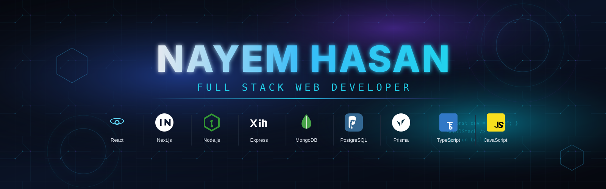

<!-- ═══════════════════════════════════════════════════════════════════════ -->
<!--                    PREMIUM PROFILE BANNER                             -->
<!-- ═══════════════════════════════════════════════════════════════════════ -->

  

<!-- ═══════════════════════════════════════════════════════════════════════ -->
<!--                        HERO GREETING                                  -->
<!-- ═══════════════════════════════════════════════════════════════════════ -->

<h1 align="center">
  
</h1>

<h3 align="center">Full Stack Web Developer</h3>

  
  

---

## About Me

I am a **Full Stack Web Developer** with a passion for learning and building modern web applications. I am currently sharpening my programming and development skills through a structured Full Stack Web Development program at **Programming Hero**.

- 🎓 Studied at **Baghair High School**
- 📚 Currently studying at **Daffodil Polytechnic Institute**
- 💻 Learning **Full Stack Web Development** through **Programming Hero**
- 🚀 I enjoy exploring new technologies and building clean, modern web experiences
- 🎯 **Current Activity:** I am currently exploring Next.js and building a modern tourism website.
- 🎯 **Goal:** to grow into a skilled Full Stack Developer by shipping real-world projects and strengthening problem-solving.

---

## My Goals

- Build and ship production-quality full stack applications
- Strengthen problem-solving and data structure fundamentals
- Master modern JavaScript, React, Node.js and database ecosystems
- Contribute to real-world projects and collaborate with other developers
- Grow toward a professional Full Stack Developer role

---

## Currently Learning

<table>
  <tr>
    <td width="50%" valign="top">
      <h4>📖 Full Stack Web Development</h4>
      
Structured learning path through <b>Programming Hero</b> — covering frontend, backend, database and deployment.

    </td>
    <td width="50%" valign="top">
      <h4>🧠 Core Development Skills</h4>
      
Continuous improvement in JavaScript, TypeScript, React, Next.js, Node.js, Express.js and database design.

    </td>
  </tr>
</table>

---

## Technology Stack

### Languages

  

### CSS Frameworks & Libraries

  

### JavaScript Frameworks & Libraries

  

### Databases & ORM

  

### Deployment Platforms

  

### Design & Graphics

  

### Tools & Technologies

  

---
## GitHub Statistics

  
  

---

## Connect With Me

  
  
  
  
  

---

## Thank You for Visiting

  <i>Thanks for stopping by my profile. Feel free to explore my repositories, and connect if you'd like to collaborate or just say hello.</i>

  

